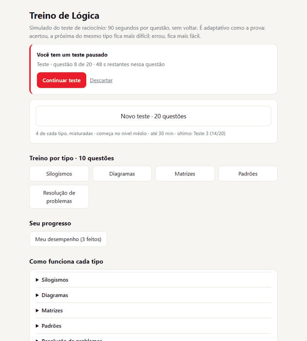
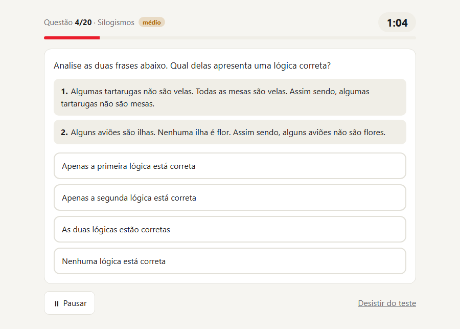
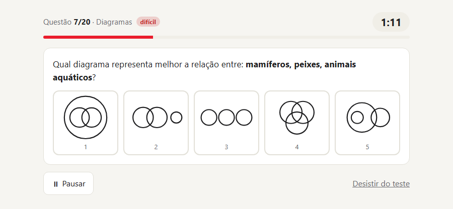
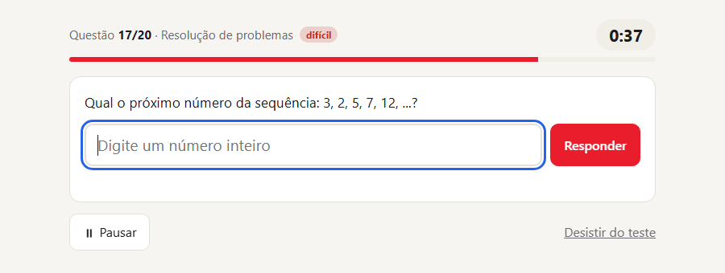
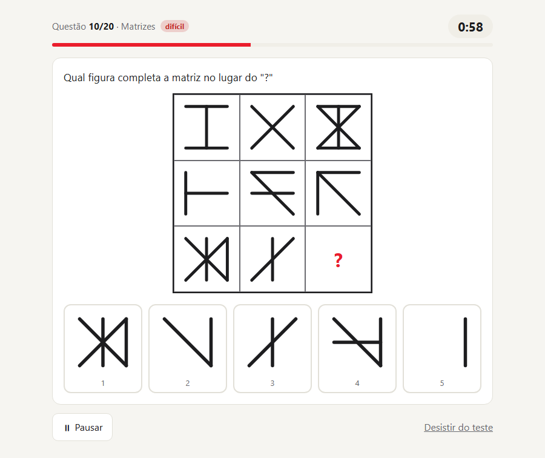
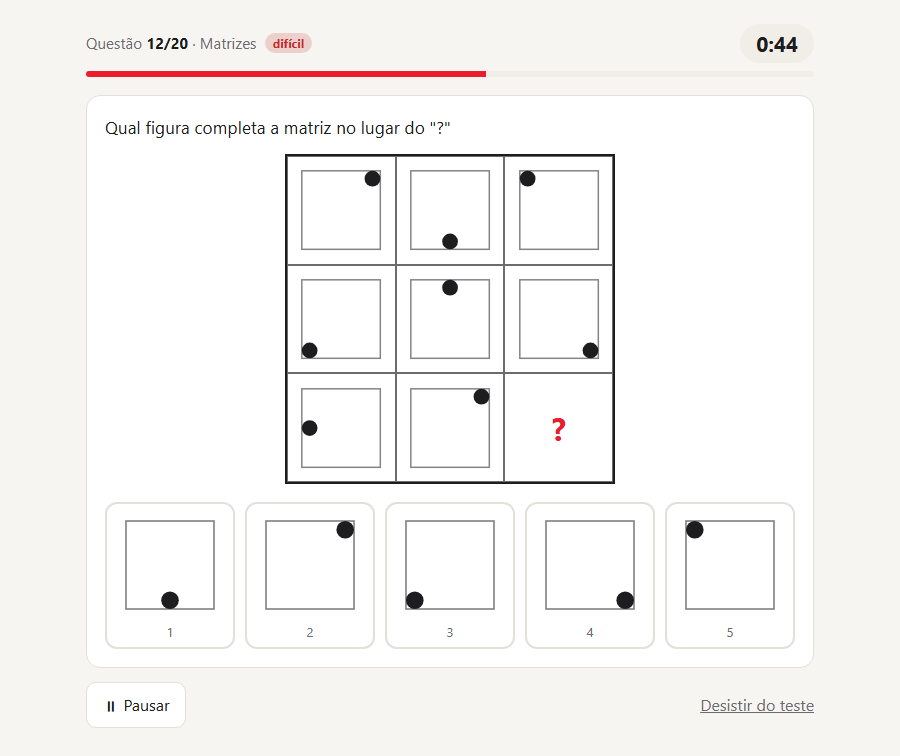
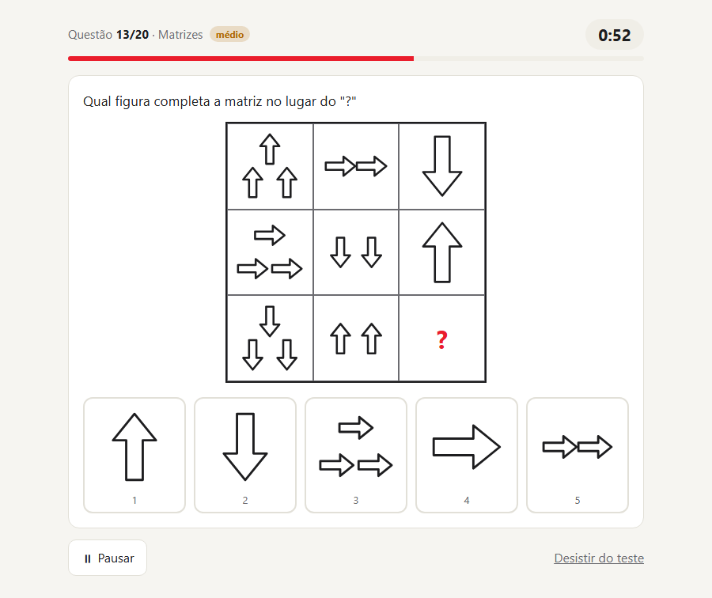
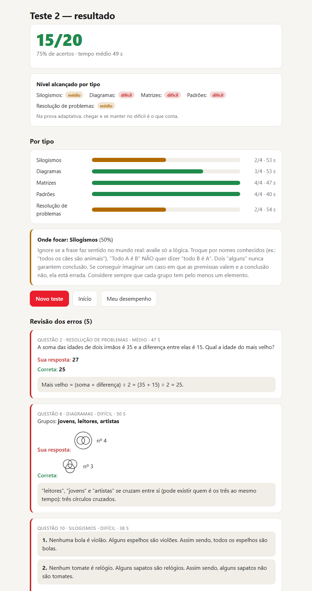
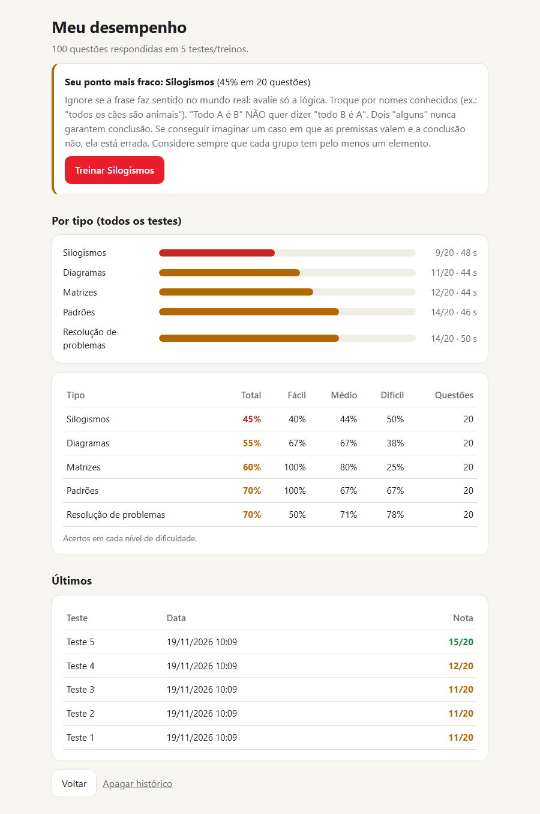

# Logic Test Trainer

**English** · [Português](README.pt-BR.md)

A practice app for the **logical reasoning test** in iFood's hiring process (GenAI role). It recreates the five question types of the real test:
- the same **90-second timer** per question;
- **adaptive difficulty**;
- a **review of every mistake** that explains why the right answer is right.

No two tests are the same. Every question is **generated on the spot**, so you can't memorize the answers and have to learn the reasoning. A test suite checks the generators and makes sure every question has **exactly one correct answer**.

**▶ [Live demo](https://lucasalan03.github.io/Treino-de-logica-teste-ifood/)**: the full app, not a mock-up. It runs entirely in the browser and works on a phone. The interface is in Portuguese, like the real test.



| Syllogisms | Diagrams | Number problems |
|---|---|---|
|  |  |  |

| Matrix: overlay (hard) | Matrix: moving dot (hard) | Matrix: two rules (medium) |
|---|---|---|
|  |  |  |

| Result and review of mistakes | Your progress |
|---|---|
|  |  |

## Why

The test is short (about 25 minutes, 90 s per question), and its URL says *adaptive*: the more you get right, the harder it gets. Static question lists don't train that. They are too easy, you end up memorizing them, and they don't show you **where** you are weak. This app is built around those three problems.

## What it does

- **Full test:** 20 questions, 4 of each type, shuffled. There are 90 s per question and no going back. When time runs out, the question counts as wrong.
- **Adaptive by type:** every type starts at *medium*. A right answer makes the next question of that type harder, and a wrong one makes it easier. The result shows the level you reached in each type.
- **Practice by type:** 10 questions of the type you want to work on.
- **Review of mistakes:** for each mistake you see:
  - your answer;
  - the right answer;
  - an explanation written for that specific question. Invalid syllogisms come with a concrete **counterexample**.
- **Progress tracking:** accuracy per type and per difficulty, average time, your weakest type with a targeted tip, and a history of past tests.
- **Pause and resume:** pick the test up later, on the same question, with the time you had left. Closing the browser also keeps it.
- **Works offline:** a single HTML file with no dependencies. You can double-click it, or use it from the live demo.

## The five question types

| Type | What you do | Easy → Medium → Hard |
|---|---|---|
| **Syllogisms** | Two short arguments ("All A are B…"). Say which are logically valid. | *all/none* only → mixed → more *some / some are not* |
| **Diagrams** | Pick the circle diagram that shows how three groups relate. | inside/separate → all 8 diagrams → only overlapping ones |
| **Matrices** | Complete a 3×3 grid of figures. | 1 rule → 2 rules with subtle distractors → overlay (OR/XOR of strokes), moving dot, counting (+/−), or 3 rules |
| **Patterns** | Five 4-letter sets: find the one that breaks the rule. | consecutive, double letter → skips of 2/3, mirrors, vowels → growing skips (ABDG), alternating (ACBD), opposite letters (A↔Z) |
| **Number problems** | Type an integer answer. | ratios, percentages, rule of three → inverse rule, ages, averages, sequences → two taps filling a tank, cars meeting, successive discounts, simple interest, profit, Fibonacci and squares |

## How every answer key is guaranteed

The app is for studying, so a wrong answer key is the worst possible bug: it would teach wrong reasoning. The generators are built to avoid that, and the tests check it:

- **Syllogisms are solved, not hand-labelled.** Every pair of premises is checked against all possible worlds: 3 sets give 7 Venn regions and 2⁷ combinations. A conclusion is valid only if it holds in every world where the premises hold. The smallest world where it fails becomes the counterexample shown to the user. Conclusions that depend on "each group has at least one member" (the classic convention in these tests) are flagged in the explanation.
- **Patterns reject ambiguity.** The generator throws out any question where another rule in the catalogue, or a common-sense check like "the only set without a vowel", would point to a different odd one out.
- **Matrices are solved back from the grid.** Each question records its rule, and the tests confirm that only the correct option completes the grid. In hard overlay questions, the example rows always include overlapping strokes, so OR and XOR can't be confused.
- **Number problems are built backwards from an integer answer**, so there are no fractions or rounding.
- **19 tests** generate **thousands of questions per type and level** and check all of the above.

## Architecture

```
treino-logica.html
├── /*GEN-START*/ … /*GEN-END*/   pure logic, no DOM: seeded RNG, the 5 generators,
│                                 syllogism solver, matrix checker, adaptive levels
└── UI                            screens, 90 s timer (clock-based), pause/resume, SVG drawing,
                                  history in localStorage (all wrapped in try/catch)
scripts/
├── carregar.js                   extracts the GEN block from the HTML and runs it in Node
└── validar.test.js               node:test suite
```

- **One file, no build step, no dependencies.** It opens straight from disk, works offline, and is published to GitHub Pages as-is.
- **Logic and interface are kept apart.** The pure part lives between markers inside the HTML. The test loader extracts it and runs it in Node, so the same code the browser runs is the code under test.
- **The figures are drawn as SVG from small descriptors.** A matrix cell is data like `{shape, size, count, fill, rot}`, so the generator, the checker and the renderer all share one representation. The figures use `currentColor`, so light and dark themes work.
- **The timer runs on the clock.** It is based on `Date.now()`, so a background tab can't freeze it, and an answer given after the deadline counts as a timeout.

## How to run

Download or clone the repository and open `treino-logica.html` in any browser. That's it.

### Tests

```bash
node --test scripts/
```

You need Node 18 or later. The tests import nothing outside Node.

## Project layout

```
treino-logica.html   the whole app
scripts/             test loader and test suite
docs/img/            screenshots and the tour GIF
docs/superpowers/    design spec and implementation plan
```

- Design spec: [docs/superpowers/specs/2026-11-14-treino-logica-design.md](docs/superpowers/specs/2026-11-14-treino-logica-design.md)
- Implementation plan: [docs/superpowers/plans/2026-11-14-treino-logica.md](docs/superpowers/plans/2026-11-14-treino-logica.md)

**Stack:** HTML, CSS, vanilla JavaScript, SVG, `node:test`. Built with Claude Code.
