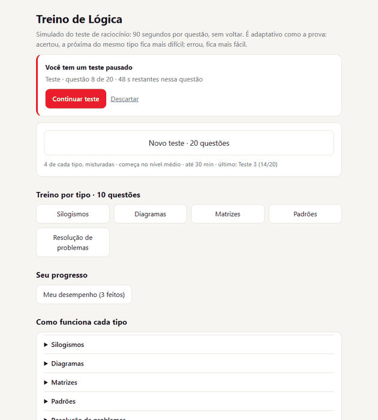
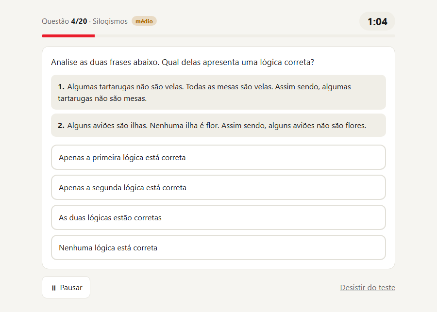
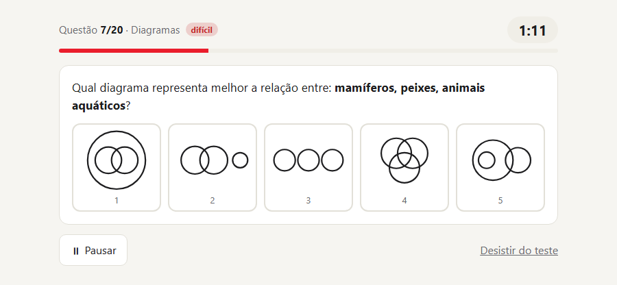
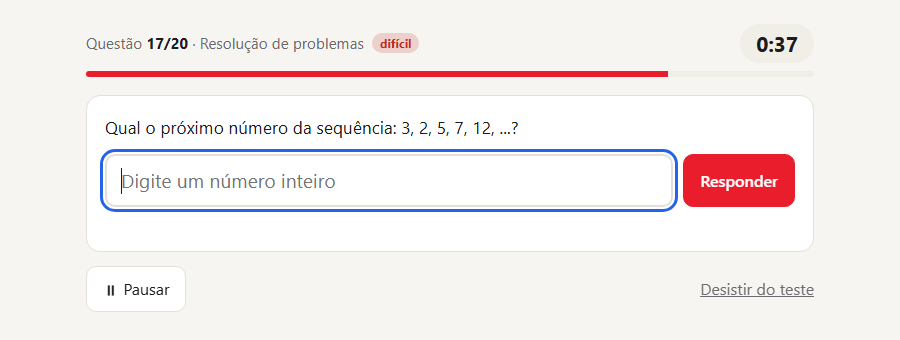
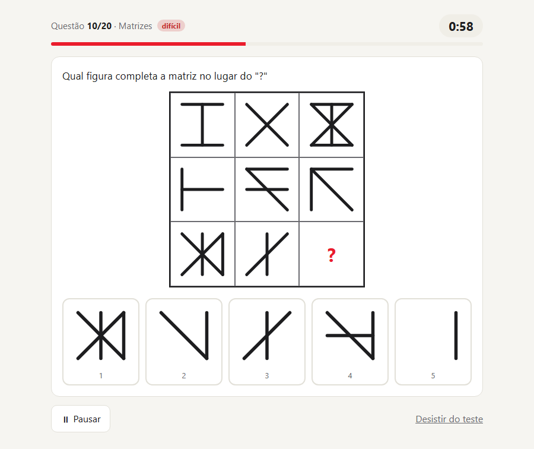
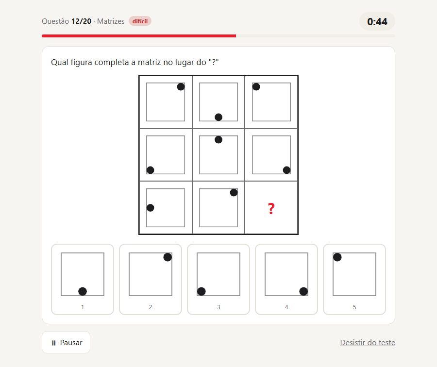
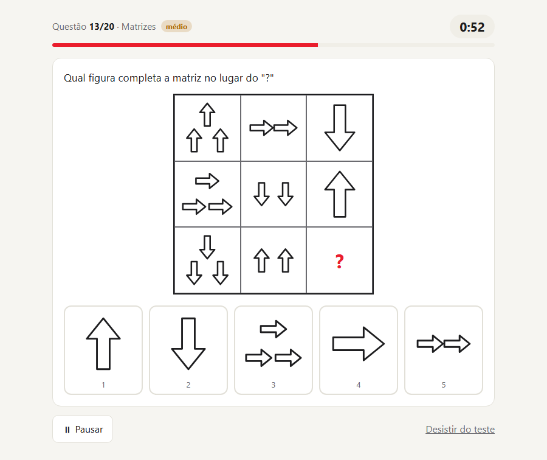
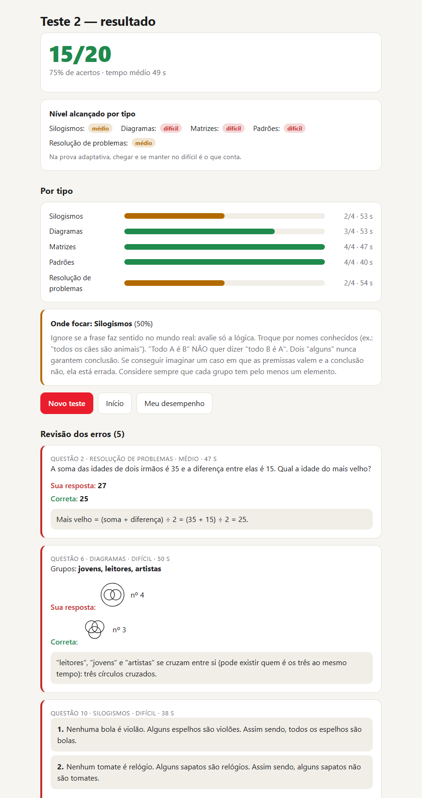
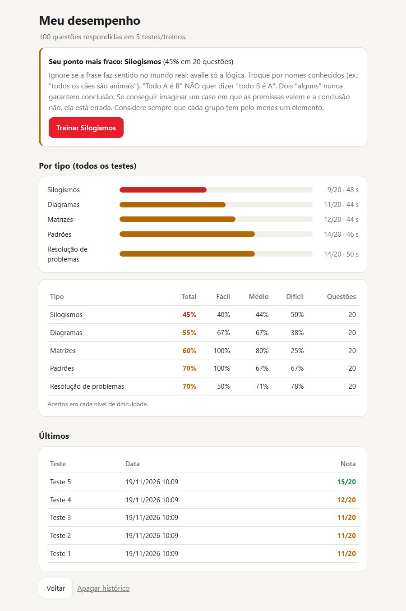

# Treino de Lógica

[English](README.md) · **Português**

Um app para treinar o **teste de raciocínio lógico** do processo seletivo do iFood (vaga de GenAI). Ele recria os cinco tipos de questão da prova real:
- o mesmo **cronômetro de 90 segundos** por questão;
- **dificuldade adaptativa**;
- **revisão de cada erro**, explicando por que a resposta certa é a certa.

Nenhum teste se repete. Cada questão é **gerada na hora**, então não dá para decorar as respostas e você precisa aprender o raciocínio. Uma bateria de testes confere os geradores e garante que toda questão tem **exatamente uma resposta certa**.

**▶ [Live demo](https://lucasalan03.github.io/Treino-de-logica-teste-ifood/)**: o app completo, não uma vitrine. Roda inteiro no navegador e funciona no celular.



| Silogismos | Diagramas | Resolução de problemas |
|---|---|---|
|  |  |  |

| Matriz: sobreposição (difícil) | Matriz: ponto que anda (difícil) | Matriz: duas regras (médio) |
|---|---|---|
|  |  |  |

| Resultado e revisão dos erros | Seu desempenho |
|---|---|
|  |  |

## Por quê

A prova é curta (cerca de 25 minutos, 90 s por questão), e o endereço dela diz *adaptativo*: quanto mais você acerta, mais difícil fica. Listas fixas de questões não treinam isso. São fáceis demais, você acaba decorando e elas não mostram **onde** você está fraco. O app foi feito em torno desses três problemas.

## O que ele faz

- **Teste completo:** 20 questões, 4 de cada tipo, misturadas. São 90 s por questão, sem voltar. Quando o tempo acaba, a questão conta como erro.
- **Adaptativo por tipo:** cada tipo começa no *médio*. Se você acerta, a próxima questão daquele tipo fica mais difícil; se erra, fica mais fácil. O resultado mostra o nível que você alcançou em cada tipo.
- **Treino por tipo:** 10 questões do tipo que você quer reforçar.
- **Revisão dos erros:** para cada erro aparecem:
  - a sua resposta;
  - a resposta certa;
  - uma explicação feita para aquela questão. Nos silogismos inválidos vem um **contraexemplo** concreto.
- **Acompanhamento:** acertos por tipo e por nível, tempo médio, seu ponto mais fraco com uma dica específica e o histórico dos testes.
- **Pausar e continuar:** você retoma o teste depois, na mesma questão, com o tempo que faltava. Se fechar o navegador, ele também fica salvo.
- **Funciona sem internet:** é um único arquivo HTML, sem dependências. Dá para abrir com dois cliques ou usar pelo live demo.

## Os cinco tipos de questão

| Tipo | O que você faz | Fácil → Médio → Difícil |
|---|---|---|
| **Silogismos** | Dois argumentos curtos ("Todos os A são B…"). Diga quais têm lógica correta. | só *todo/nenhum* → misturado → mais *alguns / alguns não* |
| **Diagramas** | Escolha o desenho de círculos que mostra como três grupos se relacionam. | dentro/separado → os 8 desenhos → só os que se cruzam |
| **Matrizes** | Complete uma grade 3×3 de figuras. | 1 regra → 2 regras com pegadinhas sutis → sobreposição (OU / OU exclusivo de traços), ponto que anda, contagem (+/−) ou 3 regras |
| **Padrões** | Cinco conjuntos de 4 letras: ache o que quebra a regra. | consecutivas, letra dupla → saltos de 2/3, espelho, vogais → saltos crescentes (ABDG), alternado (ACBD), letras opostas (A↔Z) |
| **Resolução de problemas** | Digite a resposta, um número inteiro. | proporção, porcentagem, regra de três → inversa, idades, média, sequências → torneiras, encontro de carros, descontos sucessivos, juros simples, lucro, Fibonacci e quadrados |

## Como cada gabarito é garantido

O app é para estudar, então um gabarito errado é o pior defeito possível: ensinaria o raciocínio errado. Os geradores foram feitos para evitar isso, e os testes conferem:

- **Os silogismos são resolvidos, não rotulados à mão.** Cada par de premissas é testado contra todos os mundos possíveis: 3 conjuntos dão 7 regiões do diagrama de Venn e 2⁷ combinações. Uma conclusão só é válida se for verdadeira em todos os mundos onde as premissas são verdadeiras. O menor mundo em que ela falha vira o contraexemplo mostrado na revisão. As conclusões que dependem de "cada grupo ter pelo menos um elemento" (a convenção clássica desses testes) vêm com um aviso na explicação.
- **Os padrões rejeitam ambiguidade.** O gerador descarta qualquer questão em que outra regra do catálogo, ou uma checagem de bom senso como "o único conjunto sem vogal", apontaria outro conjunto diferente.
- **As matrizes são resolvidas a partir da grade.** Cada questão guarda a sua regra, e os testes confirmam que só a alternativa certa completa a grade. Nas sobreposições difíceis, as linhas de exemplo sempre têm traços repetidos, para que não dê para confundir OU com OU exclusivo.
- **Os problemas são montados de trás para frente, a partir de uma resposta inteira**, então não aparecem frações nem arredondamentos.
- **19 testes** geram **milhares de questões por tipo e por nível** e conferem tudo isso.

## Arquitetura

```
treino-logica.html
├── /*GEN-START*/ … /*GEN-END*/   lógica pura, sem DOM: RNG com semente, os 5 geradores,
│                                 resolvedor de silogismos, checagem das matrizes, níveis
└── Interface                     telas, cronômetro de 90 s (pelo relógio), pausa, desenhos SVG,
                                  histórico no localStorage (sempre com try/catch)
scripts/
├── carregar.js                   extrai o bloco GEN do HTML e o executa no Node
└── validar.test.js               testes com node:test
```

- **Um arquivo só, sem build e sem dependências.** Abre direto do disco, funciona offline e vai para o GitHub Pages do jeito que está.
- **Lógica e interface ficam separadas.** A parte pura fica entre marcadores dentro do HTML. O carregador de testes extrai esse trecho e roda no Node, então o código testado é o mesmo que o navegador executa.
- **As figuras são desenhadas em SVG a partir de descritores pequenos.** Uma célula da matriz é um dado como `{shape, size, count, fill, rot}`, então o gerador, a checagem e o desenho usam a mesma representação. As figuras usam `currentColor`, então funcionam nos temas claro e escuro.
- **O cronômetro segue o relógio.** Ele usa `Date.now()`, então uma aba em segundo plano não congela o tempo, e uma resposta dada depois do prazo conta como tempo esgotado.

## Como usar

Baixe ou clone o repositório e abra `treino-logica.html` em qualquer navegador. Só isso.

### Testes

```bash
node --test scripts/
```

Precisa do Node 18 ou mais novo. Os testes não importam nada além do próprio Node.

## Estrutura do projeto

```
treino-logica.html   o app inteiro
scripts/             carregador e testes
docs/img/            capturas de tela e o GIF do tour
docs/superpowers/    spec de design e plano de implementação
```

- Spec de design: [docs/superpowers/specs/2026-11-14-treino-logica-design.md](docs/superpowers/specs/2026-11-14-treino-logica-design.md)
- Plano de implementação: [docs/superpowers/plans/2026-11-14-treino-logica.md](docs/superpowers/plans/2026-11-14-treino-logica.md)

**Stack:** HTML, CSS, JavaScript puro, SVG, `node:test`. Feito com Claude Code.
